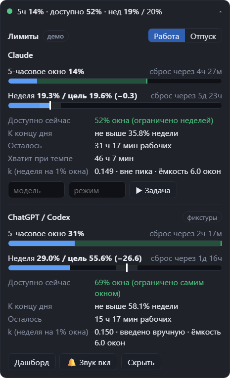
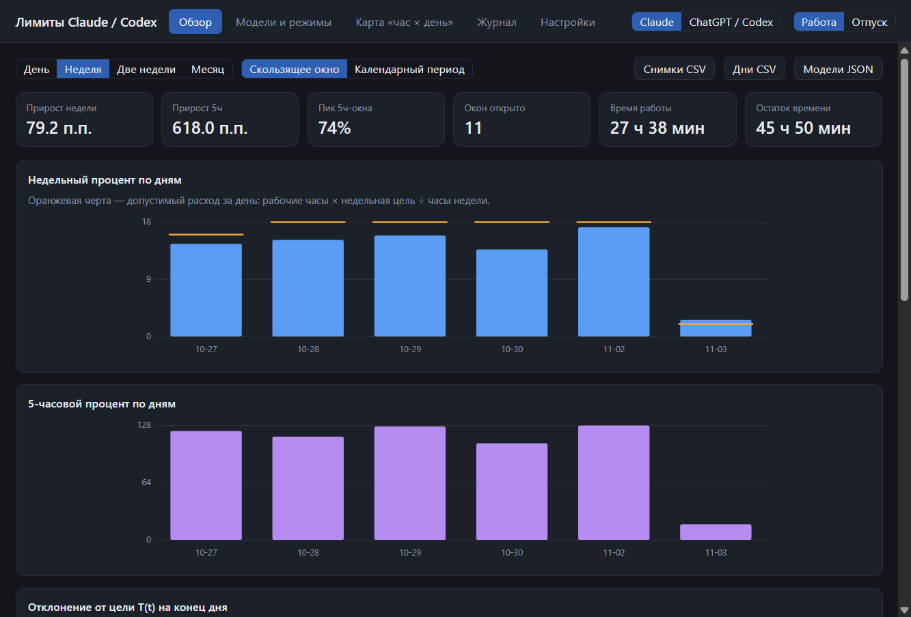

# Виджет лимитов Claude

[](https://github.com/dancyuser/limit-budget/actions/workflows/ci.yml)
[](LICENSE)

Плавающий виджет для Windows. Показывает остаток лимитов Claude (Pro) и подсказывает, **сколько процентов 5-часового окна можно потратить прямо сейчас**,
чтобы уложиться в недельный лимит. Расчёт идёт по вашему рабочему расписанию: по умолчанию пн–пт, 10:00–14:00 и 15:00–19:00 в UTC+3 (меняется в настройках).
Поддержка Codex в ChatGPT Desktop заложена в архитектуре (отдельный адаптер), но пока работает только на тестовых данных.

> **English in short.** A Windows always-on-top widget (Electron + TypeScript) that reads your Claude Pro usage limits and tells you how much of the current 5-hour window you can spend
> without exhausting the weekly limit, based on your own working schedule. It has a stats dashboard, anomaly detection for limit changes, sounds, a SOCKS5/HTTP proxy setting and a CLI.
> The UI and docs are in Russian. It is unofficial and uses an undocumented claude.ai endpoint through your own signed-in session; see the disclaimer below.




Снимки сделаны в демо-режиме на симулированных данных.

## Возможности

* **Компактная строка** `5ч 34% · доступно 26% · нед 41% / 38%` и **карточка** с двумя шкалами, временем до сброса, остатком рабочих часов, подсказкой «хватит при текущем темпе».
* **«Доступно сейчас»**: какую долю 5-часового окна можно потратить, чтобы к концу недели остаться в рамках цели (с запасом 10%).
* **Дашборд**: расход по дням против допустимого, периоды день / неделя / две недели / месяц, тепловая карта «час × день недели», проценты по моделям и режимам.
* **Детектор изменений лимитов**: находит «тяжёлые часы» и сдвиг недельного показателя, но всегда называет их «возможным изменением».
* **Звуки и уведомления**: разные сигналы для предупреждения и превышения, свои звуки или файлы, быстрое выключение.
* **Режимы «Работа» и «Отпуск»**, учёт пиковых часов, ручная отметка модели и режима, журнал пометок.
* **Прокси** (SOCKS5, HTTP) в настройках, ключом запуска или переменной окружения.
* **Вход в Claude без ручного копирования cookie**: окно входа внутри приложения (включая вход через Google) или сессия из установленного Claude Desktop.
* **Командная строка**: статус, статистика, экспорт CSV/JSON, повторный прогон истории, поиск пропусков в опросе.
* Все данные лежат на вашем компьютере, облака и телеметрии нет.



## Установка

Готовый установщик лежит в разделе [Releases](https://github.com/dancyuser/limit-budget/releases/latest). Он не подписан, поэтому SmartScreen попросит подтвердить запуск. Подробная инструкция, сборка из исходников,
вход в Claude и настройка прокси — в [docs/INSTALL.md](docs/INSTALL.md).

Коротко из исходников (Windows, Node.js 22.13+):

```bash
git clone https://github.com/dancyuser/limit-budget.git
cd limit-budget
npm install
npm run demo     # попробовать на симулированных данных
npm start        # настоящий запуск, потребуется вход в Claude
```

## Документация

| Документ | О чём |
| --- | --- |
| [docs/INSTALL.md](docs/INSTALL.md) | Установка, обновление, удаление, первый вход, частые проблемы |
| [docs/USAGE.md](docs/USAGE.md) | Что показывает виджет, прокси, командная строка, шаг 0 |
| [docs/ARCHITECTURE.md](docs/ARCHITECTURE.md) | Формулы расчёта, структура кода, база, состояние проекта, ограничения |
| [docs/data-sources.md](docs/data-sources.md) | Результаты проверки источников данных: ответ claude.ai, Codex, срез недели по продуктам |
| [CONTRIBUTING.md](CONTRIBUTING.md) | Как собрать, проверить и предложить изменение |
| [SECURITY.md](SECURITY.md) | Какие данные хранятся и как сообщить об уязвимости |
| [CHANGELOG.md](CHANGELOG.md) | История версий |

## Отказ от ответственности

Проект **неофициальный** и не связан с Anthropic и OpenAI. Claude, Codex, ChatGPT — товарные знаки их владельцев.

* Виджет читает использование из **недокументированного внутреннего эндпоинта** claude.ai через вашу собственную залогиненную сессию. Он может перестать работать в любой момент, если сервис изменит ответ.
  Если форма ответа не совпадает с ожидаемой, виджет показывает ошибку, а не нули.
* Тип запросов (опрос раз в минуту из страницы claude.ai) похож на работу самого сайта, но **условия использования сервиса вы проверяете сами**. Запасной вход через сессию Claude Desktop читает чужое для приложения
  хранилище cookie; он запускается только вашей кнопкой и в фоне выключен по умолчанию.
* Расчёт бюджета — подсказка по вашему расписанию, а не гарантия: реальные лимиты определяет сервис.
* Программа предоставляется «как есть», без гарантий; см. [LICENSE](LICENSE).

## Лицензия

[MIT](LICENSE)
