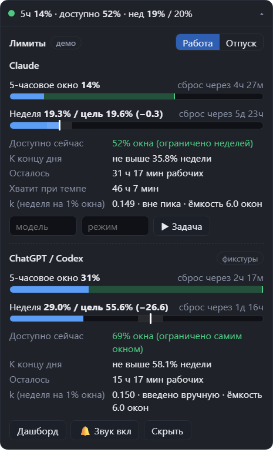
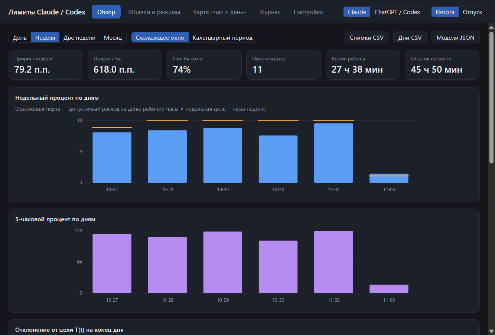

# Работа с виджетом

## Что показывает виджет

* **Компактная строка** (по умолчанию): `5ч 34% · доступно 26% · нед 41% / 38%`. Цвет точки: зелёный — на траектории,
  жёлтый — выше траектории или «доступно» близко к нулю, красный — лимит выбран. ⚡ — идут пиковые часы.
* **Карточка** по клику: две шкалы (5-часовая с зелёным сегментом «доступно сейчас»; недельная с маркером цели и
  полосой ±δ), время до сброса, остаток в рабочих часах, «хватит при текущем темпе», k, метка пиковых часов,
  переключатель «Работа / Отпуск», ручная отметка модели и режима, кнопка «Задача».
* Окно без рамки, поверх остальных, перетаскивается, запоминает позицию и монитор, возвращается в видимую область
  при смене монитора, может быть полупрозрачным и пропускать клики.
* **Дашборд**: день / неделя / две недели / месяц, скользящее окно или календарный период; расход по дням против допустимого,
  отклонение от цели, «доступно сейчас» и отклонение на начало и конец каждого блока, время работы и проценты по
  моделям и режимам, пик и не пик, тепловая карта «час × день недели», журнал пометок и найденных изменений лимитов, настройки.
* **Звуки** в любое время (в обед и вне рабочих окон тоже): у предупреждения и у превышения лимита разные сигналы,
  у каждого события свой звук или свой файл, громкость, быстрое выключение. Уведомления Windows дублируют сигналы без звука.
* **Значок в трее**: показать/скрыть виджет, дашборд, режим «Работа / Отпуск», звуки, вход, прокси, шаг 0 (спайк), автозапуск.





Снимки сделаны в демо-режиме на симулированных данных (карточка ChatGPT / Codex — обезличенные фикстуры, поэтому там красные шкалы).

## Обновление данных и потеря связи

Виджет опрашивает claude.ai раз в минуту (вдвое чаще, пока процент растёт). Если связи нет, он не ждёт следующей минуты, а повторяет попытку сам:

* после **временного сбоя** (нет связи, источник не ответил за 30 секунд) повторы идут через 5, 10, 20 и 30 секунд, потом обычный интервал; пока связи нет, в карточке написано,
  когда будет следующая попытка;
* при **пробуждении компьютера** (сон, гибернация) виджет закрывает старые соединения, перезагружает скрытую страницу claude.ai и сразу опрашивает заново: после гибернации сеть и прокси
  поднимаются не мгновенно, а старые соединения мертвы;
* когда Windows сообщает, что **сеть вернулась**, опрос идёт сразу;
* если связи нет уже второй раз подряд (и затем каждый шестой), соединения сбрасываются ещё раз;
* кнопка **«↻»** (в компактной строке при ошибке, в карточке и в сообщении об ошибке) и пункт трея **«Обновить сейчас»** опрашивают немедленно; если с данными что-то не так, перед этим сбрасываются соединения.

Ошибки «нужен вход» и «форма ответа не совпала» быстрыми повторами не лечатся, поэтому для них действует обычный интервал.

Пока данные устарели и время сброса недели уже прошло, виджет показывает расход новой недели как 0%, а не прошлый расход (иначе он красным показывал бы «+56» относительно цели новой недели). Такие значения
помечены «устарело» и исправляются первым же успешным опросом.

## Прокси

Все сетевые запросы виджета (вход в claude.ai, опрос использования) идут через Chromium внутри Electron, поэтому прокси задаётся один раз и действует на всё.
Способы, по убыванию приоритета:

| Способ | Пример |
| --- | --- |
| Ключ запуска | `node scripts/start.mjs --proxy 10808` · `LimitBudget.exe --proxy socks5://127.0.0.1:10808` |
| Переменная окружения | `LIMIT_BUDGET_PROXY=socks5://127.0.0.1:10808` |
| Настройки (хранится в базе) | значок в трее → «Настроить прокси (порт)…» → режим «Свой прокси», тип SOCKS5, адрес 127.0.0.1, порт 10808 → «Применить и проверить» |

В настройках прокси задаётся полями «Режим / Тип / Адрес / Порт» (порт подсказывается списком: 10808, 10809, 7890…), после «Применить и проверить» сразу видно, дошёл ли запрос
до claude.ai, и появляется кнопка «Войти в Claude…». Если claude.ai недоступен при первом запуске, программа сама предложит указать порт, а виджет при ошибке связи
показывает ссылку «Настроить прокси».

Формат значения в ключе запуска и переменной окружения:

* `10808` — то же, что `socks5://127.0.0.1:10808`;
* `host:port` без схемы — socks5; допустимы схемы `socks5`, `socks4`, `http`, `https`;
* `off` — без прокси; пусто — системные настройки Windows;
* логин и пароль в адресе Chromium не принимает; локальные адреса (`localhost`, `127.0.0.1`) идут напрямую.

Особенности:

* **PowerShell и `npm start -- --proxy 10808`:** не работает: `npm` там — это `npm.ps1`, а PowerShell проглатывает `--`, и ключ достаётся самому npm. Используйте
  `node scripts/start.mjs --proxy 10808`, `npm run start:proxy` (порт 10808 зашит в скрипт), `npm.cmd start -- --proxy 10808`, `npm start '--' --proxy 10808`
  или переменную окружения.
* Ключ запуска и переменная действуют только на этот запуск и перекрывают поле в настройках; чтобы прокси применялся всегда (в том числе при автозапуске
  вместе с Windows), впишите его в настройки.
* Неверное значение в `--proxy` останавливает запуск с сообщением: молча идти в обход прокси нельзя. Неверное значение, сохранённое в настройках, отвергается ещё при сохранении.
* Повторный запуск с `--proxy`, пока виджет уже работает, переключает работающий экземпляр на новый прокси.
* Все окна приложения, которые открывают claude.ai (скрытая страница опроса, окно входа и всплывающее окно «Войти через Google»), живут в одной сессии с этим прокси;
  проверка связи показывает путь каждого открытого окна и отдельно — доходит ли через прокси Google (`accounts.google.com`). Ссылка «Открыть claude.ai в браузере» открывает ваш обычный браузер,
  и он ходит так, как настроен сам (прокси приложения на него не действует).
* «Применить и проверить» и пункт трея «Проверить связь с claude.ai» показывают, что реально выбирает Chromium (`SOCKS5 127.0.0.1:10808` или `DIRECT`),
  код ответа и страну выхода по данным Cloudflare; IP-адрес не сохраняется. Те же строки попадают в отчёт шага 0 (раздел «Сеть»).
* Для `socks5://` имена хостов разрешает сам прокси, так что DNS-запросов мимо него нет.

## Командная строка

Работает с той же базой, что и виджет (по умолчанию `%APPDATA%\LimitBudget\usage.sqlite`, или `--db`, или `LIMIT_BUDGET_DB`).
Запуск из исходников; сначала `npm run build`.

```bash
npm run cli -- status --json               # состояние: факт, цель, «доступно сейчас»
npm run cli -- stats --period week --mode calendar
npm run cli -- export --what days --period month --out days.csv      # snapshots | days | models | blocks
npm run cli -- replay --from 2026-10-26    # сохранённая история через калькулятор
npm run cli -- gaps --days 7               # пропуски в снимках: критерий «7 дней без пропусков»
npm run cli -- seed-demo --days 30 --db demo.sqlite
```

## Шаг 0: проверка источников данных

Пункт трея «Шаг 0: спайк источников данных» (или вкладка «Настройки» → «Запустить спайк») снимает обезличенные образцы ответов claude.ai, проверяет сеть и прокси,
долговечность cookie и находит логи Codex. Отчёт `data-sources.generated.md` пишется в `%APPDATA%\LimitBudget\spike`. Значения cookie, тексты разговоров и идентификаторы
в него не попадают, но в нём есть ваши проценты использования и тариф: просматривайте отчёт, прежде чем куда-то выкладывать.
Если форма ответа claude.ai изменится, менять нужно только `packages/app/src/providers/claude.ts`.
